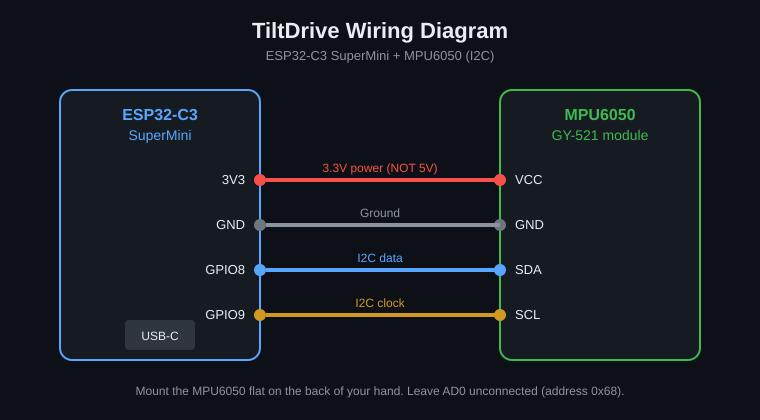

# Wiring

| MPU6050 pin | ESP32-C3 SuperMini | Wire colour (suggested) |
|-------------|-------------------|-------------------------|
| VCC | 3V3 | Red |
| GND | GND | Black |
| SDA | GPIO 8 | Blue |
| SCL | GPIO 9 | Yellow |

Leave **AD0, INT and XDA/XCL** unconnected.

## Notes

- Use **3V3**, not 5V.
- GPIO9 is also the BOOT button. Do not hold BOOT while plugging in or the chip enters download mode.
- GPIO8 is tied to the onboard LED. This does not affect I2C.
- If your I2C scan shows `0x69` instead of `0x68`, change `MPU_ADDR` in the firmware.
- Mount the module **flat on the back of your hand**, with the chip facing up, and keep it fixed. A loose sensor gives jittery input.
